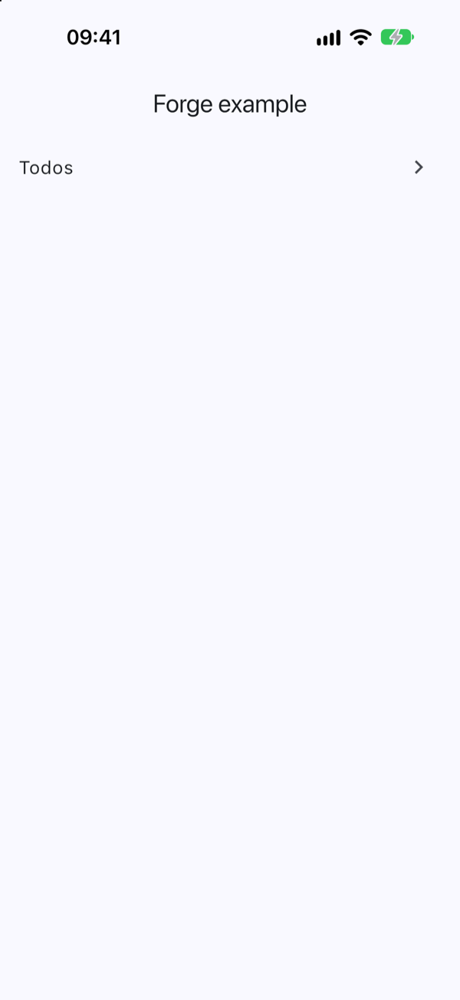
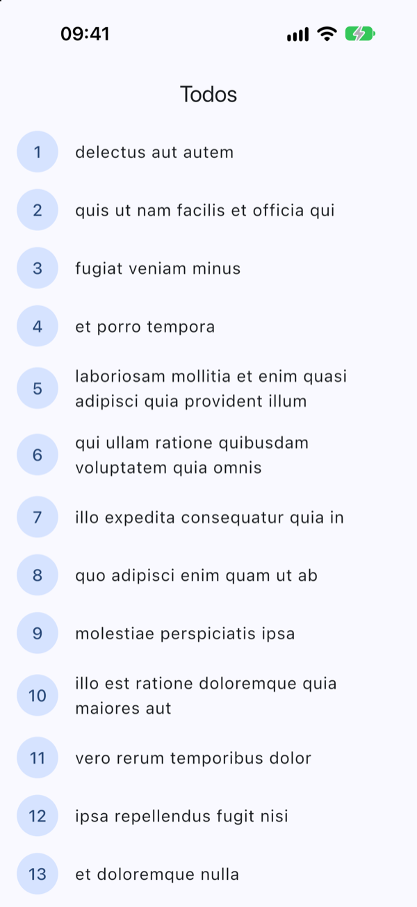
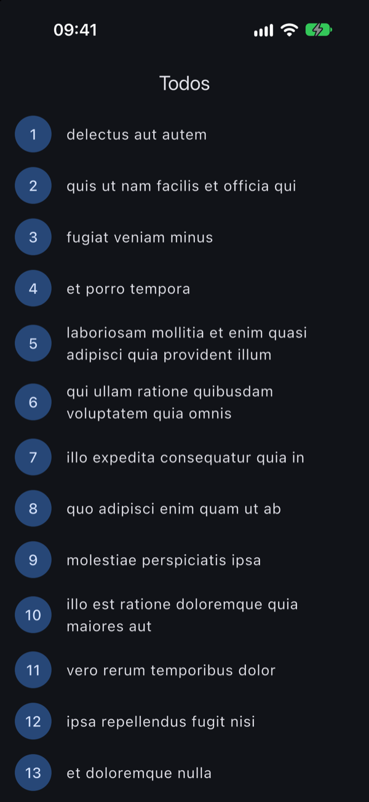
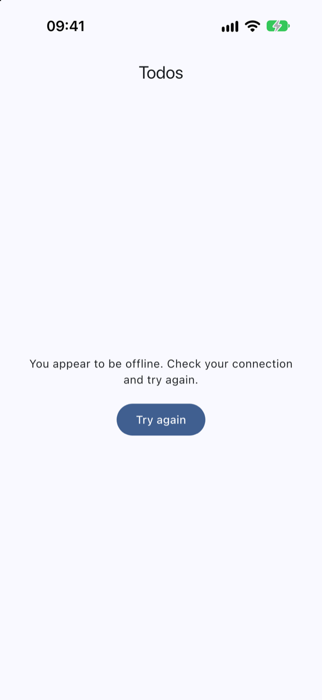

<!-- i18n-source: README.md@bd6de8e9a9d78d66fc0db6a6e9edbb03acfd83f6 status=reviewed -->
<!-- brand:start -->

<p align="center"><picture><source media="(prefers-color-scheme: dark)" srcset="https://raw.githubusercontent.com/muhittincamdali/FlutterForge/main/.github/brand/banner-dark.svg"><source media="(prefers-color-scheme: light)" srcset="https://raw.githubusercontent.com/muhittincamdali/FlutterForge/main/.github/brand/banner-light.svg"></picture></p>

<!-- lang-selector:start -->
<p align="center"><a href="README.md">English</a> · <a href="README.tr.md">Türkçe</a> · <a href="README.zh-CN.md">简体中文</a> · <a href="README.ja.md">日本語</a> · <a href="README.ko.md">한국어</a> · <a href="README.es.md">Español</a> · <a href="README.de.md">Deutsch</a> · <a href="README.fr.md">Français</a> · <a href="README.pt-BR.md">Português (Brasil)</a> · <a href="README.ru.md">Русский</a></p>
<!-- lang-selector:end -->

<p align="center">
<a href="https://github.com/muhittincamdali/FlutterForge/actions/workflows/ci.yml"></a>
<a href="https://github.com/muhittincamdali/FlutterForge/releases"><picture><source media="(prefers-color-scheme: dark)" srcset="https://raw.githubusercontent.com/muhittincamdali/FlutterForge/main/.github/brand/badge-version-dark.svg"><source media="(prefers-color-scheme: light)" srcset="https://raw.githubusercontent.com/muhittincamdali/FlutterForge/main/.github/brand/badge-version-light.svg"></picture></a>
<a href="https://github.com/muhittincamdali/FlutterForge/blob/main/pubspec.yaml"><picture><source media="(prefers-color-scheme: dark)" srcset="https://raw.githubusercontent.com/muhittincamdali/FlutterForge/main/.github/brand/badge-language-dark.svg"><source media="(prefers-color-scheme: light)" srcset="https://raw.githubusercontent.com/muhittincamdali/FlutterForge/main/.github/brand/badge-language-light.svg"></picture></a>
<a href="https://github.com/muhittincamdali/FlutterForge/blob/main/LICENSE"><picture><source media="(prefers-color-scheme: dark)" srcset="https://raw.githubusercontent.com/muhittincamdali/FlutterForge/main/.github/brand/badge-license-dark.svg"><source media="(prefers-color-scheme: light)" srcset="https://raw.githubusercontent.com/muhittincamdali/FlutterForge/main/.github/brand/badge-license-light.svg"></picture></a>
</p>

<p align="center">
<a href="#início-rápido"><picture><source media="(prefers-color-scheme: dark)" srcset="https://raw.githubusercontent.com/muhittincamdali/FlutterForge/main/.github/brand/button-start-pt-BR-dark.svg"><source media="(prefers-color-scheme: light)" srcset="https://raw.githubusercontent.com/muhittincamdali/FlutterForge/main/.github/brand/button-start-pt-BR-light.svg"></picture></a>
<a href="https://muhittincamdali.github.io/FlutterForge/"><picture><source media="(prefers-color-scheme: dark)" srcset="https://raw.githubusercontent.com/muhittincamdali/FlutterForge/main/.github/brand/button-docs-pt-BR-dark.svg"><source media="(prefers-color-scheme: light)" srcset="https://raw.githubusercontent.com/muhittincamdali/FlutterForge/main/.github/brand/button-docs-pt-BR-light.svg"></picture></a>
<a href="https://github.com/muhittincamdali/FlutterForge/tree/main/example"><picture><source media="(prefers-color-scheme: dark)" srcset="https://raw.githubusercontent.com/muhittincamdali/FlutterForge/main/.github/brand/button-examples-pt-BR-dark.svg"><source media="(prefers-color-scheme: light)" srcset="https://raw.githubusercontent.com/muhittincamdali/FlutterForge/main/.github/brand/button-examples-pt-BR-light.svg"></picture></a>
</p>

> Esta é uma tradução do README em inglês. Se houver diferença, vale a versão em inglês.

<!-- brand:end -->

O FlutterForge reúne, em um único pacote Dart, duas ferramentas para quem desenvolve com Flutter. O `ForgeClient` é um cliente JSON-over-HTTP construído sobre o [`package:http`](https://pub.dev/packages/http) que refaz requisições, guarda respostas em cache, renova bearer tokens, limita o tempo e o tamanho da resposta e recusa redirecionamentos inseguros. O `forge` é um comando que cria um app Flutter — ou adiciona uma funcionalidade a um já existente — com uma estrutura feature-first, Riverpod, go_router, esse cliente e testes para cada camada, de modo que um projeto novo já começa com código que passa em `flutter analyze` e `flutter test`. Você pode usar o cliente sem o comando, e o app gerado é código Flutter comum que você pode alterar.

## Destaques

- **Um único tipo de erro para tratar** — toda falha é uma `ApiException` selada (sealed), então um `switch` sobre ela é verificado pelo compilador, e o `toString` dela cita apenas o método e o host, nunca o caminho, a query, os headers ou o corpo.
- **Novas tentativas seguras de repetir** — requisições idempotentes são repetidas após erros de conexão, timeouts e `408`/`429`/`5xx`, com backoff com jitter e respeitando o `Retry-After`; `POST` e `PATCH` não são repetidas, a menos que você peça.
- **Cache pensado para uso offline** — `networkFirst` recorre à última resposta quando o dispositivo está offline; `cacheFirst` revalida com `ETag` e `Last-Modified`. O cache em memória é limitado por número de entradas e por bytes.
- **Tokens que ficam onde devem ficar** — o bearer token vai apenas para o origin da API, respostas `401` simultâneas compartilham uma única renovação, e redirecionamentos para outro origin descartam `Authorization` e `Cookie` (exceto na web, onde o navegador segue os redirecionamentos).
- **Limites por padrão** — um limite de 30 s por tentativa, um limite de resposta de 16 MiB que também interrompe corpos infinitos, um cancelamento que fecha a conexão e valores de header que não conseguem injetar uma nova linha de header.
- **Um gerador cuja saída é testada** — o [app de exemplo](example) é exatamente a saída de `forge create`; o CI o analisa e o testa, e um teste falha se ele se afastar dos templates.

## Início rápido

**1. Instale o comando `forge`**

```sh
dart pub global activate --source git https://github.com/muhittincamdali/FlutterForge.git --git-ref v2.0.0
```

Você precisa do [Flutter](https://docs.flutter.dev/install) 3.44 ou mais recente, que já inclui o Dart. Se o terminal responder `forge: command not found`, adicione ao seu `PATH` a pasta que o Dart mostrou (`$HOME/.pub-cache/bin` no macOS e no Linux, `%LOCALAPPDATA%\Pub\Cache\bin` no Windows) e abra um novo terminal.

**2. Crie um app**

```sh
forge create my_app
```

Isso executa `flutter create` para as pastas de Android e iOS, escreve o app, seus testes e um workflow do GitHub Actions que os verifica, e executa `flutter pub get`. Adicione `--org com.yourcompany` para definir o id do app, ou `--platforms ios,android,web,macos` para incluir mais plataformas.

**3. Execute**

```sh
cd my_app
flutter run
```

O app abre em uma tela inicial com uma entrada **Todos**; toque nela para carregar uma lista de `jsonplaceholder.typicode.com`. Execute `flutter test` para ver os testes gerados passarem e `forge feature orders` para adicionar uma segunda tela com seus próprios testes.

## Instalação

Para usar apenas o cliente HTTP em um projeto Flutter ou Dart existente, adicione o pacote ao `pubspec.yaml`:

```yaml
dependencies:
  flutter_forge:
    git:
      url: https://github.com/muhittincamdali/FlutterForge.git
      ref: v2.0.0
```

Depois execute `flutter pub get` (ou `dart pub get`) e importe-o:

```dart
import 'package:flutter_forge/flutter_forge.dart';
```

O pacote depende apenas de `http`, `http_parser`, `args` e `path`, e roda em Android, iOS, macOS, Windows, Linux, na web e na VM do Dart. Ele é instalado pelo Git porque o nome `flutter_forge` no pub.dev pertence a outro pacote, já descontinuado.

A versão 2.0.0 é uma reescrita: o código-fonte da 1.0.0 não compilava, e nada da API dela existe mais. O [CHANGELOG.md](CHANGELOG.md) traz os detalhes.

## Uso

Todos os exemplos abaixo também estão em [test/readme_test.dart](test/readme_test.dart), que os executa contra um servidor falso.

### Chamar uma API

```dart
final class Todo {
  const Todo({required this.id, required this.title});

  final int id;
  final String title;

  static Todo fromJson(Object? json) => switch (json) {
    {'id': final int id, 'title': final String title} => Todo(id: id, title: title),
    _ => throw const FormatException('Not a todo'),
  };

  static List<Todo> listFromJson(Object? json) => [for (final item in json! as List<Object?>) fromJson(item)];
}

final client = ForgeClient(baseUrl: 'https://jsonplaceholder.typicode.com');
final todo = await client.getJson('/todos/1', decode: Todo.fromJson);
print(todo.title); // delectus aut autem

final created = await client.postJson('/todos', json: {'title': 'Ship it'}, decode: (json) => json);
```

Caminhos relativos são anexados à URL base. Tudo o que `decode` lança vira uma `DecodingException`.

### Tratar falhas

```dart
String messageFor(Object error) => switch (error) {
  ConnectionException() => 'You appear to be offline.',
  RequestTimeoutException() => 'The server took too long to answer.',
  HttpStatusException(statusCode: 404) => 'Not found.',
  HttpStatusException(:final statusCode) => 'The server answered $statusCode.',
  ApiException() => 'Something went wrong.',
  _ => 'Unexpected error: $error',
};

try {
  await client.getJson('/todos/999', decode: Todo.fromJson);
} on ApiException catch (error) {
  print(messageFor(error)); // Not found.
}
```

`HttpStatusException.response` guarda o corpo que o servidor enviou junto com o erro.

### Guardar a última resposta para uso offline

```dart
final cache = MemoryResponseCache(maxEntries: 200, maxBytes: 4 * 1024 * 1024);
final client = ForgeClient(baseUrl: 'https://api.example.com', cache: cache);

final todos = await client.getJson(
  '/todos',
  decode: Todo.listFromJson,
  cachePolicy: CachePolicy.networkFirst, // the network, or the last answer when offline
);
```

Use `CachePolicy.cacheFirst` para pular a requisição enquanto a resposta armazenada estiver atual, e chame `cache.clear()` quando o usuário autenticado mudar.

### Enviar um bearer token

```dart
final client = ForgeClient(
  baseUrl: 'https://api.example.com',
  auth: BearerAuth(
    readToken: () => tokenStore.accessToken,
    refreshToken: tokenStore.refresh, // called once on 401, shared by parallel requests
  ),
);
```

`refresh` guarda o novo token e o retorna, ou retorna `null` quando o usuário precisa entrar novamente.

### Testar sem um servidor

```dart
final client = ForgeClient(
  baseUrl: 'https://api.example.com',
  retry: RetryPolicy.none,
  httpClient: MockClient((request) async {
    expect(request.url.path, '/todos');
    return http.Response(jsonEncode([
      {'id': 1, 'title': 'Test'},
    ]), 200);
  }),
);

expect(await client.getJson('/todos', decode: Todo.listFromJson), hasLength(1));
```

`MockClient` vem de `package:http/testing.dart`.

### Adicionar uma funcionalidade a um app gerado

```sh
forge feature orders                                   # Order, GET /orders
forge feature order_items --api-path /v2/order-items   # OrderItem
forge feature news --entity Article                    # when the singular is not obvious
```

Cada comando escreve `lib/features/<name>/{domain,data,presentation}` e dois arquivos de teste, adiciona a rota em `lib/app/router.dart`, adiciona a tela à tela inicial e formata o que alterou. Nomes que não compilariam, como uma funcionalidade cuja entidade se chamaria `Text`, são recusados antes de qualquer coisa ser escrita.

## Capturas de tela

O app de exemplo em um simulador de iPhone 18 Pro (iOS 27), com dados reais de `jsonplaceholder.typicode.com`:

| Início | Todos | Todos, escuro | Offline |
| --- | --- | --- | --- |
|  |  |  |  |

O [`scripts/screenshots.sh`](scripts/screenshots.sh) compila o exemplo e tira essas capturas de tela. Para executar o exemplo você mesmo:

```sh
cd example
flutter run
```

## Documentação

- [Referência da API e guias](https://muhittincamdali.github.io/FlutterForge/) — gerados com `dart doc` e publicados no GitHub Pages a partir de `main`.
- Para gerar localmente, execute `dart doc --output build/doc` e abra `build/doc/index.html`.
- `forge --help`, `forge create --help` e `forge feature --help` listam todas as opções.

## Guias

- [Chamando uma API com o ForgeClient](doc/guides/calling-an-api.md) — requisições tipadas, erros, novas tentativas, cache, tokens, cancelamento, interceptors e testes.
- [Criando um app com o forge](doc/guides/creating-an-app.md) — criar um app, entender sua estrutura, adicionar uma funcionalidade, apontá-lo para a sua API e adicionar um campo.
- [Contra o que o cliente protege](doc/guides/security-model.md) — redirecionamentos, injeção de headers, limites de memória, números maliciosos e o que fica por sua conta.

## Requisitos

| Ferramentas | Versão mínima |
| --- | --- |
| Dart (biblioteca e `forge`) | 3.12 |
| Flutter (apps gerados) | 3.44 |

Os apps gerados usam Riverpod 3.4, go_router 18.1 e `http` 1.6. O pacote é desenvolvido e testado com Flutter 3.47 e Dart 3.13; o CI usa a versão estável mais recente do Flutter.

## Arquitetura

- `lib/src/network/` — o `ForgeClient` monta uma cadeia de interceptors em volta de um transporte: os seus interceptors, depois `CacheInterceptor`, `RetryInterceptor` e `BearerAuthInterceptor`. O transporte envia uma requisição pelo `package:http` com os redirecionamentos desativados, segue os redirecionamentos por conta própria, aplica o limite de tempo com requisições `Abortable` e lê o corpo com um limite de bytes. Requisições e respostas são valores imutáveis.
- `lib/src/cli/` — `forge` é um `CommandRunner` do `package:args`. Os templates são constantes de string do Dart renderizadas por um substituidor de `{{key}}` rigoroso, que falha quando falta um valor; os nomes são validados antes de qualquer arquivo ser tocado, e os arquivos só são escritos dentro do projeto.
- `example/` — a saída de `forge create`, dependendo deste checkout com `path: ..`.
- `test/` — testes unitários do cliente (com um `http.Client` falso que suporta abortar e corpos em streaming), da CLI (com um process runner falso em uma pasta temporária), dos exemplos do README e um teste que regenera o exemplo e o compara arquivo por arquivo.

Execute as verificações localmente:

```sh
dart analyze && dart test
cd example && flutter analyze && flutter test
```

## Roteiro

- Progresso de upload e download para corpos grandes.
- Um `ResponseCache` persistente (arquivos ou SQLite) ao lado do `MemoryResponseCache`.
- Mais templates do `forge`: localização e build flavors para o app novo.

## Como contribuir

Contribuições são bem-vindas. Leia o [guia de contribuição](https://github.com/muhittincamdali/FlutterForge/blob/main/CONTRIBUTING.md) e o [código de conduta](https://github.com/muhittincamdali/.github/blob/main/CODE_OF_CONDUCT.md) antes de abrir um pull request. Relate problemas de segurança de forma privada, como descrito na [política de segurança](https://github.com/muhittincamdali/.github/blob/main/SECURITY.md).

## Licença

Publicado sob a licença MIT. Veja [LICENSE](LICENSE).
